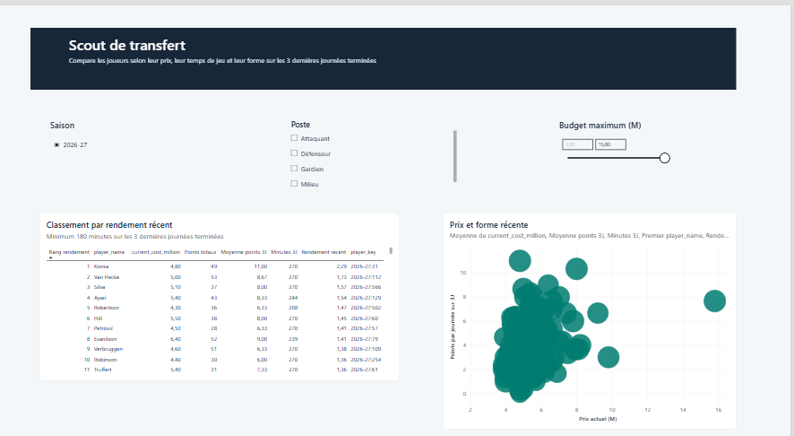
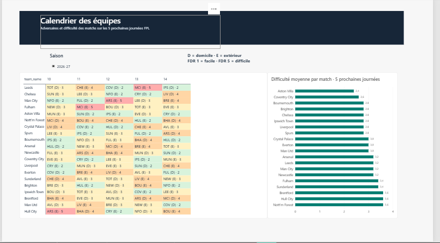
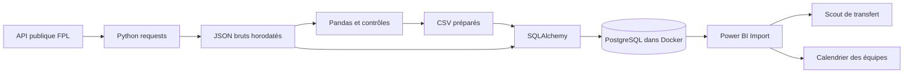
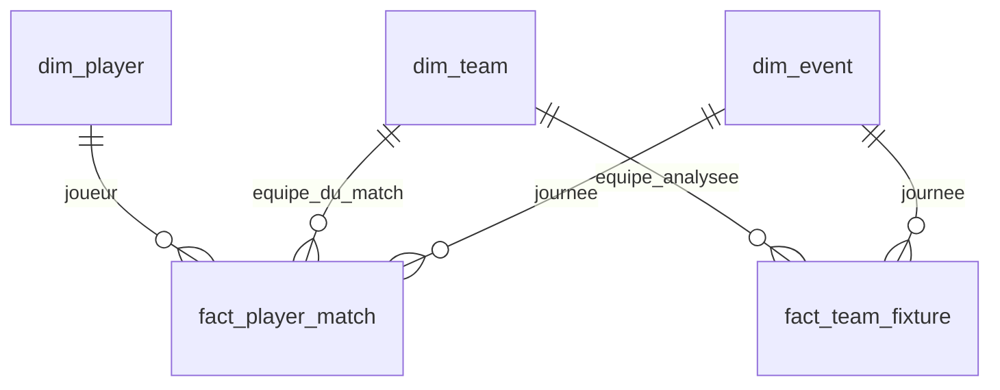

# FPL Analytics — Data Engineering & Business Intelligence

Un pipeline analytique de bout en bout pour comparer les joueurs de Fantasy Premier League et analyser la difficulté du calendrier des équipes. Les données publiques FPL sont extraites avec Python, préparées avec Pandas, chargées dans PostgreSQL et explorées dans Power BI.

Le rapport aide à répondre à deux questions métier.

- Quels joueurs offrent le meilleur rendement récent pour un poste et un budget donnés ?
- Quelles équipes disposent du calendrier le plus favorable sur les cinq prochaines journées FPL ?

## Aperçu du rapport

### Scout de transfert

Filtres de saison, de poste et de budget, classement par rendement récent et nuage de points comparant le prix à la forme. La taille des bulles représente les minutes jouées sur la période.



### Calendrier des équipes

Matrice des adversaires par club et par journée, avec indication domicile/extérieur et couleur selon le Fixture Difficulty Rating (FDR). Un graphique classe les clubs par difficulté moyenne des matchs de la période.



Les captures correspondent à un instantané du projet. Les valeurs évoluent à chaque actualisation. Une page Vérification permet de rapprocher les mesures Power BI des résultats SQL.

## Stack technique

| Couche | Technologies | Rôle |
|---|---|---|
| Extraction | Python, requests | Appels HTTP et conservation des réponses JSON |
| Transformation | Pandas | Typage, contrôles, sélection des colonnes et métriques |
| Chargement | SQLAlchemy, psycopg2 | Tables, contraintes, transactions et upserts |
| Stockage | PostgreSQL 18, Docker Compose | Base locale et volume persistant |
| Visualisation | Power BI Desktop, DAX | Modèle relationnel, mesures et rapport en mode Import |
| Configuration | python-dotenv, .env | Paramètres locaux de connexion et saison |
| Développement | VS Code, terminal, Git/GitHub | Exécution, suivi du code et documentation |

## Architecture



Les fichiers bruts permettent de retrouver la réponse d'origine et de rejouer les transformations. PostgreSQL centralise les tables et impose l'intégrité des relations. Power BI importe ces tables pour calculer les indicateurs dans le contexte des filtres du rapport.

## Sources et processus

| Point d'accès FPL | Données utilisées |
|---|---|
| `/api/bootstrap-static/` | Joueurs, équipes et journées |
| `/api/element-summary/{player_id}/` | Historique des performances individuelles par match |
| `/api/fixtures/` | Rencontres, équipes domicile/extérieur et difficultés |

### 1. Extraction de l'instantané

`scripts/extract_fpl.py` récupère `bootstrap-static`, vérifie le statut HTTP et la présence des collections `elements`, `teams` et `events`. Il conserve la réponse complète dans un JSON horodaté en UTC sous `data/raw/`.

### 2. Nettoyage et préparation

`scripts/transform_fpl.py` sélectionne le dernier instantané selon son nom horodaté et produit `players.csv`, `teams.csv` et `events.csv` sous `data/processed/`.

Les transformations comprennent la conversion des types, le nettoyage des textes, la conversion du prix FPL en millions (`now_cost / 10`) et le calcul des points par million et de `xG + xA`. Le nom du fichier source est conservé dans les trois CSV. Les joueurs à zéro minute restent disponibles dans les données.

### 3. Historique et chargement analytique

`scripts/load_fpl.py` lit les CSV, récupère les rencontres et l'historique de chaque joueur, puis conserve les réponses dans `data/raw/history_<horodatage>/`. Les appels d'historique disposent de tentatives supplémentaires pour certaines erreurs HTTP et d'une pause entre joueurs.

L'équipe au moment d'une performance est retrouvée à partir de la rencontre et du statut domicile/extérieur. Les dimensions et les performances sont chargées dans une transaction après l'extraction. Les upserts s'appuient sur les clés primaires pour actualiser une ligne existante lors d'une nouvelle exécution.

### 4. Préparation du calendrier

`scripts/load_fixtures.py` utilise le dernier `fixtures.json` disponible et crée deux lignes par rencontre ayant une journée attribuée, une pour chaque équipe. Il charge le FDR correspondant à chaque perspective. Les lignes du calendrier de la saison sont remplacées dans une transaction afin de prendre en compte les changements de programmation.

### 5. Modèle Power BI et visualisation

Les dimensions filtrent les faits par des relations actives de cardinalité `1:*`, à sens unique. Les indicateurs récents sont calculés en DAX. Les deux pages partagent une palette et une typographie définies dans `powerbi/fpl-theme.json`.

## Modélisation SQL

Le schéma PostgreSQL `fpl` contient deux tables de faits partageant trois dimensions.

| Table | Grain | Clé primaire |
|---|---|---|
| `dim_player` | Un joueur pour une saison | `player_key` |
| `dim_team` | Une équipe pour une saison | `team_key` |
| `dim_event` | Une journée FPL pour une saison | `event_key` |
| `fact_player_match` | Un joueur pour un match | `player_key`, `fixture_id` |
| `fact_team_fixture` | Une équipe pour une rencontre | `team_key`, `fixture_id` |

Les clés des dimensions combinent la saison et l'identifiant FPL, par exemple `2026-27:100`. Le détail par match permet de conserver deux performances lorsqu'un joueur dispute une double journée, puis de les agréger au niveau de la journée.



## Définition des indicateurs

| Indicateur | Définition et unité |
|---|---|
| Points totaux | Somme des points dans le contexte de filtre courant |
| Moyenne points 3J | Points des trois dernières journées terminées divisés par le nombre de journées retenues |
| Minutes 3J | Somme des minutes sur cette même période |
| Rendement récent | Moyenne points 3J divisée par le prix actuel en millions, soit des points par journée et par million |
| Rang rendement | Classement décroissant du rendement parmi les joueurs sélectionnés ayant au moins 180 minutes sur la période |
| Points par million | Points cumulés de saison divisés par le prix actuel, calculés dans la transformation Pandas |
| Contributions attendues | `xG + xA`, calculé dans la transformation Pandas |
| FDR moyen | Moyenne des notes FDR par match dans la période sélectionnée |

Les mesures 3J utilisent les journées marquées `finished = true`. Elles conservent la saison sélectionnée et ignorent le filtre sur le numéro de journée pour retrouver leur fenêtre récente. Une journée sans points compte pour zéro. Si seules une ou deux journées sont terminées, le diviseur correspond à ce nombre de journées.

Une double journée compte une fois dans la moyenne par journée et peut contribuer deux matchs aux totaux. Le rang utilise un arrondi à quatre décimales et partage le même rang entre ex æquo, avec un classement dense.

Le calendrier commence à la journée marquée `is_next = true` et retient jusqu'à cinq numéros de journée. Le FDR va de 1 à 5, du plus facile au plus difficile. Chaque match possède le même poids dans la moyenne. Pour une double journée, la couleur de la case reprend le FDR maximal et le texte affiche les deux adversaires avec leurs notes. Les rencontres sans journée attribuée sont exclues de cette vue.

## Organisation du dépôt

```text
fpl-analytics/
├── scripts/
│   ├── extract_fpl.py
│   ├── transform_fpl.py
│   ├── load_fpl.py
│   └── load_fixtures.py
├── docs/images/
│   ├── scout-transfert.png
│   └── calendrier-equipes.png
├── powerbi/
│   └── fpl-theme.json
├── docker-compose.yml
├── requirements.txt
├── .env.example
├── .gitignore
└── README.md
```

`data/raw/`, `data/processed/`, `.venv/` et `.env` sont créés localement et exclus du suivi Git. Le rapport est conçu dans Power BI Desktop. Son fichier `.pbix`, lorsqu'il est ajouté au dépôt, se trouve dans `powerbi/`.

## Installation locale

Les commandes suivantes sont destinées à PowerShell sous Windows. Le projet a été développé avec Python 3.12. Installer Git, Python, Docker Desktop avec Docker Compose et Power BI Desktop avant de commencer.

### Récupérer le projet et installer les dépendances

```powershell
git clone https://github.com/rayanaissi1/fpl-analytics.git
cd fpl-analytics
python -m venv .venv
.\.venv\Scripts\python.exe -m pip install -r requirements.txt
Copy-Item .env.example .env
```

Renseigner un mot de passe local dans `.env` et adapter `FPL_SEASON` à la saison réellement renvoyée par l'API. Cette variable étiquette les données chargées. La modifier ne demande pas une ancienne saison à l'API.

### Démarrer PostgreSQL

```powershell
docker compose config --quiet
docker compose up -d --wait
docker compose ps
docker compose exec postgres psql -U fpl_admin -d fpl_analytics -c "SELECT current_database(), version();"
```

PostgreSQL écoute sur `127.0.0.1` au port défini dans `.env`, avec `5432` par défaut. Le volume nommé conserve les données lorsque le conteneur est recréé. Pour libérer le service en conservant ce volume, utiliser `docker compose down`.

### Exécuter le pipeline

Exécuter chaque commande après la réussite de la précédente.

```powershell
.\.venv\Scripts\python.exe scripts\extract_fpl.py
.\.venv\Scripts\python.exe scripts\transform_fpl.py
.\.venv\Scripts\python.exe scripts\load_fpl.py
.\.venv\Scripts\python.exe scripts\load_fixtures.py
```

Le chargement des historiques effectue un appel par joueur et peut prendre plusieurs minutes. L'extraction d'un nouvel instantané et le chargement de ses historiques doivent être exécutés dans la même session de mise à jour.

### Configurer le compte de lecture Power BI

Après le premier chargement, ouvrir `psql` avec le compte d'administration.

```powershell
docker compose exec postgres psql -U fpl_admin -d fpl_analytics
```

Créer le compte une seule fois et saisir son mot de passe avec la commande interactive `\password`.

```sql
CREATE ROLE fpl_bi LOGIN;
```

```text
\password fpl_bi
```

```sql
GRANT CONNECT ON DATABASE fpl_analytics TO fpl_bi;
GRANT USAGE ON SCHEMA fpl TO fpl_bi;
GRANT SELECT ON ALL TABLES IN SCHEMA fpl TO fpl_bi;
ALTER DEFAULT PRIVILEGES FOR ROLE fpl_admin IN SCHEMA fpl
GRANT SELECT ON TABLES TO fpl_bi;
```

### Connecter Power BI

Dans le connecteur PostgreSQL de Power BI Desktop, utiliser `localhost:5432` et la base `fpl_analytics`, en adaptant le port si nécessaire. Choisir Import et le compte `fpl_bi`. Importer les cinq tables du schéma `fpl`, puis vérifier les relations du diagramme ci-dessus. Le thème s'importe depuis le ruban Conception.

Après une nouvelle exécution des quatre scripts, cliquer sur Actualiser dans Power BI et enregistrer le rapport. Docker doit être démarré pour cette actualisation. Les interactions du rapport en mode Import utilisent ensuite la copie des données dans Power BI.

## Contrôles de qualité et vérification

Les scripts contrôlent les collections requises, les conversions numériques, les doublons d'identifiants, les prix positifs, les minutes non négatives et les références d'équipes ou de journées. Les clés primaires et étrangères PostgreSQL complètent ces contrôles. Les trois CSV doivent partager le même nom de fichier source. Le chargement du calendrier vérifie que les notes FDR appartiennent à l'échelle 1 à 5.

Une requête de contrôle permet de comparer le résultat SQL aux points affichés dans Power BI.

```sql
SELECT
    p.season,
    p.player_name,
    e.event_id AS gameweek,
    SUM(f.total_points) AS points,
    SUM(f.minutes) AS minutes
FROM fpl.fact_player_match AS f
JOIN fpl.dim_player AS p ON p.player_key = f.player_key
JOIN fpl.dim_event AS e ON e.event_key = f.event_key
GROUP BY p.season, p.player_key, p.player_name, e.event_id
ORDER BY p.season DESC, e.event_id DESC, points DESC
LIMIT 20;
```

Sur l'instantané utilisé pendant la construction du rapport, Van Hecke totalisait 15 points à la journée 9 dans SQL et Power BI. Pour le calendrier, les notes 2, 2, 2, 4 et 2 d'Aston Villa donnaient 2,4 dans le graphique. Ces vérifications manuelles portent sur cet instantané. Les données source peuvent être corrigées ultérieurement.

## Limites actuelles et évolutions

- Les quatre scripts sont lancés manuellement. Une erreur exige de corriger sa cause avant de poursuivre le chargement.
- Les appels API s'étalent dans le temps. La collecte ne constitue pas un instantané atomique de toute la plateforme FPL.
- Le dernier fichier brut est choisi selon son nom. Un dossier d'historique partiellement collecté peut déjà contenir `fixtures.json`. Il faut terminer `load_fpl.py` avec succès avant d'exécuter `load_fixtures.py`.
- La saison est renseignée manuellement. Les clés incluent la saison, mais la collecte et le rapport ont été construits autour d'une saison active à la fois.
- Le prix actuel et la disponibilité des joueurs sont écrasés lors des mises à jour de la dimension. Le prix associé au match est conservé dans les faits.
- Les upserts de performances ne retirent pas automatiquement une ligne disparue de la source. Le calendrier, lui, remplace les lignes de la saison.
- Le modèle conserve l'équipe du joueur au moment du match. Le Scout filtre actuellement par poste, budget et saison. Le club actuel reste à ajouter comme attribut pour un filtre de recrutement par club.
- Le classement décrit un rendement observé. Une prévision de points, des contrôles automatisés de bout en bout, une orchestration et un déploiement Power BI Service constituent des pistes d'évolution.

## Compétences mises en pratique

Consommation d'API HTTP, archivage JSON, préparation de données avec Pandas, définition du grain analytique, schéma en étoile avec dimensions partagées, SQL et contraintes d'intégrité, chargements transactionnels, mesures DAX sensibles au contexte de filtre, conception de visuels et documentation d'un environnement local reproductible.

## Sources

- [API FPL — instantané général](https://fantasy.premierleague.com/api/bootstrap-static/)
- [API FPL — rencontres](https://fantasy.premierleague.com/api/fixtures/)
- [Explication du FDR par la Premier League](https://www.premierleague.com/news/68553)
- [Connecteur PostgreSQL pour Power BI](https://learn.microsoft.com/en-us/power-query/connectors/postgresql)

Projet de portfolio indépendant réalisé par [Rayan Aissi](https://github.com/rayanaissi1). Les données et les noms d'équipes proviennent de Fantasy Premier League.
